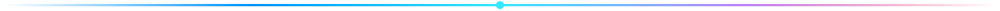

<div align="center">



<br/>

[](https://archlinux.org/)
[](https://omarchy.org/)
[](https://hypr.land/)
[](https://isocpp.org/)
[](https://www.qt.io/)
[](https://www.gnu.org/software/bash/)

</div>



## 🖼️ Visual Showcase Gallery

<table>
  <tr>
    <td width="33%" align="center">
      <a href="https://github.com/enisozen/plustv-omarchy-kit">
        
      </a>
      <br />
      <b>📺 <a href="https://github.com/enisozen/plustv-omarchy-kit">Plus TV & Omarchy Smart TV Kit</a></b>
      <br />
      <sub>4K Smart TV Hub • Mobile Web Remote • Couch Gamepad & Touch Keyboard</sub>
      <br /><br />
      <a href="https://github.com/enisozen/plustv-omarchy-kit/releases/tag/v1.0.0">
        
      </a>
    </td>
    <td width="33%" align="center">
      <a href="https://github.com/enisozen/omarchy-smurfs-theme">
        
      </a>
      <br />
      <b>🍄 <a href="https://github.com/enisozen/omarchy-smurfs-theme">The Smurfs Theme for Omarchy</a></b>
      <br />
      <sub>Magical Smurf Village Palette • Custom About Logo • Unlock & Screensaver</sub>
      <br /><br />
      <a href="https://github.com/enisozen/omarchy-smurfs-theme/releases/tag/v1.0.0">
        
      </a>
    </td>
    <td width="33%" align="center">
      <a href="https://github.com/enisozen/omarchy-digiturk-theme">
        
      </a>
      <br />
      <b>🎬 <a href="https://github.com/enisozen/omarchy-digiturk-theme">Digiturk × beIN Theme</a></b>
      <br />
      <sub>4K Sports & Cinema Palette • Amethyst & Gold • Unlock & Screensaver</sub>
      <br /><br />
      <a href="https://github.com/enisozen/omarchy-digiturk-theme/releases/tag/v1.0.0">
        
      </a>
    </td>
  </tr>
</table>


## 🔒 Custom Plymouth & SDDM Unlock Screens

<table>
  <tr>
    <td width="33%" align="center">
      <a href="https://github.com/enisozen/plustv-omarchy-kit">
        
      </a>
      <sub><b>Plus TV Unlock Screen</b></sub>
    </td>
    <td width="33%" align="center">
      <a href="https://github.com/enisozen/omarchy-smurfs-theme">
        
      </a>
      <sub><b>The Smurfs Unlock Screen</b></sub>
    </td>
    <td width="33%" align="center">
      <a href="https://github.com/enisozen/omarchy-digiturk-theme">
        
      </a>
      <sub><b>Digiturk × beIN Unlock Screen</b></sub>
    </td>
  </tr>
</table>


## ⚡ One-Command Quick Install on Omarchy Linux

```bash
# 🍄 Install The Smurfs Theme
omarchy theme install https://github.com/enisozen/omarchy-smurfs-theme

# 🎬 Install Digiturk × beIN CONNECT Theme
omarchy theme install https://github.com/enisozen/omarchy-digiturk-theme

# 📺 Install Plus TV & Smart TV Remote Control Kit
git clone https://github.com/enisozen/plustv-omarchy-kit.git && cd plustv-omarchy-kit && ./install.sh
```


<div align="center">

### 🛠️ Tech Stack & Tools

[](https://github.com/enisozen)

</div>
